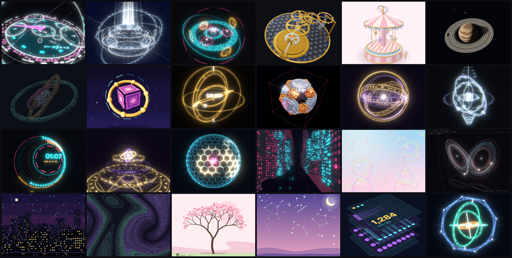
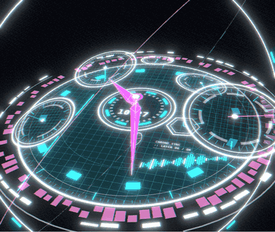
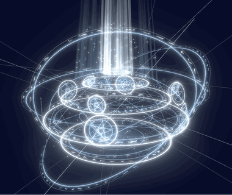
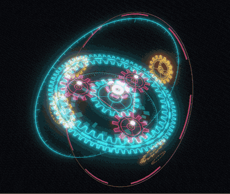
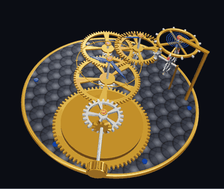
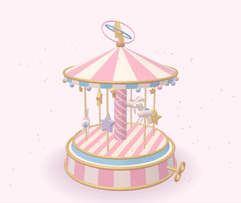
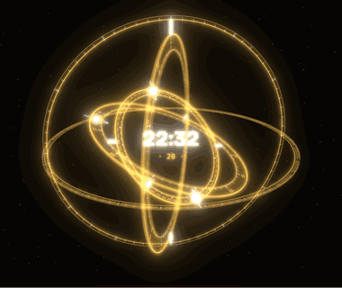
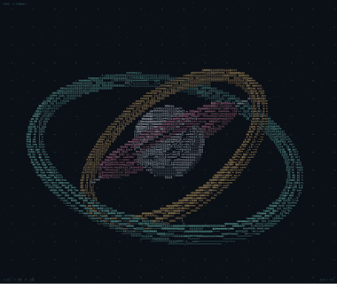
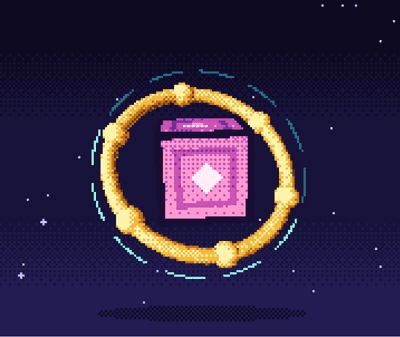

# 動きの見本帳（web-anime）

three.js と anime.js で作った、ウェブサイトに組み込めるアニメーション素材集です。素材は122点あります。サイバー、SF、ファンタジー、時計、自然、サイエンス、ファンシー、ドット絵、アスキーアートといった題材ごとの素材と、ボタンや通知のような実用の部品を収めました。一覧ページで実物の動きを見比べ、個別ページで色や速さを変えて試し、決まった設定をコードとしてコピーできます。

公開しているページで、すべての素材を動かして試せます。

https://shiyow5.github.io/web-anime/



| 副文字盤が浮かぶホログラム時計 | 天蓋の魔法陣 |
|---|---|
|  |  |
| **歯車の反応炉** | **機械式時計の中身** |
|  |  |
| **オルゴールの回転木馬** | **渾天儀の時計** |
|  |  |
| **文字のジャイロ** | **ドット絵の回る立方体** |
|  |  |

どのGIFも、始まって1秒あまりのところで中央を1回タップしています。GIFは毎秒12.5コマで色数も絞っているので、実機ではもっとなめらかで、光のにじみもきれいに出ます。

## 立体の作り方の基準

立体の素材は、板を重ねて傾けるだけで終わらせず、軸の違う回転を2本以上入れています。水平に回る輪の上で、立った小さな輪がそれぞれ自分の軸で回る。入れ子の輪が別々の軸で回る。歯車が歯数の比どおりに、かみ合う相手と逆向きに回る。こうした動きが重なると、止めて見ても立体だと分かります。

輪・目盛り・回路のような縁取りを作る部品は `src/lib/holo.js` に、走査線や映像の乱れを足す後処理は `src/lib/postfx.js` にまとめました。書き方は `docs/AUTHORING.md` にあります。

## 動かし方

Node.js 22 以上が必要です。

```bash
npm install
npm run dev
```

表示されたURLをブラウザーで開くと、一覧ページが出ます。

| コマンド | すること |
|---|---|
| `npm run dev` | 開発用サーバーを起動する |
| `npm run build` | `dist/` に公開用のファイルを書き出す |
| `npm run preview` | 書き出したファイルを手元で確認する |
| `npm test` | 単体テストを実行する |
| `npm run coverage` | 単体テストを実行し、カバレッジを表示する |
| `npm run smoke -- <id>` | 開発用サーバーを起動した状態で、指定した素材を開いて画像に撮る |
| `npm run e2e` | Chrome で全素材を開き、表示・操作・片付けを確かめる（30 分以上かかる） |

## 素材の一覧

全部で122点あります。分類ごとに並べました。

### 3D・WebGL

| id | 名前 | 使うライブラリ | 向いている場面 |
|---|---|---|---|
| `text-particles` | 文字になる粒 | three.js + anime.js | トップページの主役 |
| `liquid-orb` | 液体の球 | three.js + anime.js | トップページの主役 |
| `floating-shapes` | 浮かぶ立体 | three.js + anime.js | サービス紹介、ポートフォリオ |
| `particle-galaxy` | 渦巻き銀河 | three.js + anime.js | 暗い配色のトップページ |
| `image-ripple` | 画像の波紋と切り替え | three.js + anime.js | 写真のスライド |
| `warp-tunnel` | ワープ航法 | three.js + anime.js | ページ遷移、読み込み中 |

### サイバー

| id | 名前 | 使うライブラリ | 向いている場面 |
|---|---|---|---|
| `gear-reactor` | 歯車の反応炉 | three.js + anime.js | 仕組みや連携を見せるトップページ |
| `holo-reactor` | ホログラムの炉心 | three.js + anime.js | 稼働状況や出力の表示 |
| `data-sphere` | 情報の球 | three.js + anime.js | データを扱うサービスの主役 |
| `glitch-dial` | 乱れる計器盤 | three.js + anime.js | 数値を見せるダッシュボードの飾り |
| `axis-lock` | 多軸のダイヤル錠 | three.js + anime.js | 認証や解錠の演出 |
| `exploded-core` | 分解される装置 | three.js + anime.js | 製品の構造や仕組みの説明 |
| `iso-stack` | 等角に重なる画面 | anime.js | サービスの仕組みを層で見せる図 |
| `neon-city` | ネオンの摩天楼 | three.js + anime.js | サイバーパンク調のトップページ |
| `data-corridor` | データの回廊 | three.js + anime.js | データや通信を扱うサービスの導入 |
| `terminal-boot` | 起動する端末 | anime.js | 開発者向けサイトの導入 |
| `circuit-pulse` | 回路を走る光 | anime.js | 技術系ページの背景 |
| `glyph-rain` | 降る記号 | anime.js | 暗い配色の背景 |
| `biometric-scan` | 生体認証の走査 | anime.js | ログインや認証の演出 |
| `signal-scope` | 波形の計器 | anime.js | 音や計測を扱う画面 |

### SF

| id | 名前 | 使うライブラリ | 向いている場面 |
|---|---|---|---|
| `gyro-stabilizer` | ジャイロスコープ | three.js + anime.js | 制御や安定を伝える場面 |
| `bevel-cube` | かさ歯車の立方体 | three.js + anime.js | 連動する仕組みの紹介 |
| `target-reticle` | 立体の照準 | three.js + anime.js | 検索や追跡の演出 |
| `ring-gate` | 輪の門 | three.js + anime.js | ページの入口、切り替え |
| `holo-globe` | ホログラムの惑星 | three.js + anime.js | 技術系サイトの主役 |
| `black-hole` | ブラックホール | three.js + anime.js | 宇宙や科学の題材 |
| `hex-shield` | 六角形の防壁 | three.js + anime.js | 守る・安全を伝える場面 |
| `tesseract` | 四次元立方体 | three.js + anime.js | 研究や数学の題材 |
| `satellite-orbit` | 衛星の軌道 | three.js + anime.js | 通信や位置情報のサービス |
| `radar-sweep` | 探知レーダー | anime.js | 監視や検索の画面 |
| `neon-horizon` | ネオンの地平線 | three.js + anime.js | 音楽やゲームのサイト |
| `hud-interface` | 宇宙船の計器盤 | anime.js | 数値や状態を見せる画面 |
| `glitch-text` | 乱れる文字 | anime.js | ゲームや音楽の見出し |

### ファンタジー

| id | 名前 | 使うライブラリ | 向いている場面 |
|---|---|---|---|
| `sigil-dome` | 天蓋の魔法陣 | three.js + anime.js | ゲームや物語のトップページ |
| `rune-sphere` | 召喚の球 | three.js + anime.js | 発動や召喚の演出 |
| `gear-orrery` | 歯車じかけの天球儀 | three.js + anime.js | 世界観を見せる導入 |
| `arcane-gyro` | 立体の魔法陣 | three.js + anime.js | ゲームや物語のトップページ |
| `magic-circle` | 魔法陣 | anime.js | ゲーム風の演出、読み込み中 |
| `crystal-gem` | 魔力の結晶 | three.js + anime.js | 商品や特典の見せ場 |
| `portal-vortex` | 渦の門 | three.js + anime.js | ページの入口 |
| `firefly-forest` | 蛍の森 | three.js | 物語調のページの背景 |

### 時計

| id | 名前 | 使うライブラリ | 向いている場面 |
|---|---|---|---|
| `holo-chronograph` | 副文字盤が浮かぶホログラム時計 | three.js + anime.js | トップページの主役、待ち受け画面 |
| `armillary-clock` | 渾天儀の時計 | three.js + anime.js | 飾りを兼ねた時刻の表示 |
| `clockwork-movement` | 機械式時計の中身 | three.js + anime.js | 精密さや職人仕事を伝えるページ |
| `chrono-core` | 多層のサイバー時計 | three.js + anime.js | トップページの主役、待ち受け画面 |
| `strata-clock` | 地層のように重なる時計 | anime.js | WebGL を使わない立体の時計 |
| `flip-clock` | めくれる時計 | anime.js | 時刻の表示、カウントダウンの土台 |
| `analog-clock` | 針の時計 | anime.js | 時刻の表示 |
| `orbit-clock` | 軌道の時計 | three.js + anime.js | 飾りを兼ねた時刻の表示 |
| `particle-clock` | 粒の時計 | three.js + anime.js | トップページの主役 |

### 自然・和風

| id | 名前 | 使うライブラリ | 向いている場面 |
|---|---|---|---|
| `rain-ripples` | 雨の波紋 | three.js | 落ち着いたページの背景 |
| `sakura-fall` | 桜吹雪 | three.js | 和風のサイト、春の告知 |
| `aurora-sky` | オーロラの空 | three.js | 夜の景色の背景 |
| `ocean-waves` | 打ち寄せる波 | anime.js | 旅行や夏の告知 |
| `growing-tree` | 伸びる木 | anime.js | 成長や季節を伝えるページ |
| `snow-fall` | 降る雪 | three.js | 冬の告知 |
| `koi-pond` | 鯉の池 | anime.js | 和風のサイトの背景 |
| `cloud-drift` | 流れる雲 | three.js | 明るい配色の背景 |
| `lightning-storm` | 雷の夜 | anime.js | 緊張感のある導入 |
| `flower-bloom` | 開く花 | anime.js | お祝い、美容や花のサイト |
| `planet-rings` | 環を持つ惑星 | three.js + anime.js | 宇宙や天文の題材、静かな背景 |

### サイエンス

| id | 名前 | 使うライブラリ | 向いている場面 |
|---|---|---|---|
| `dna-helix` | DNA の二重らせん | three.js + anime.js | 医療や生命科学のサイト |
| `atom-orbitals` | 原子の電子雲 | three.js + anime.js | 化学の解説 |
| `solar-system` | 太陽系の公転 | three.js + anime.js | 天文の解説 |
| `fourier-draw` | フーリエ級数の作図 | anime.js | 数学や信号処理の解説 |
| `pendulum-wave` | 振り子の波 | three.js + anime.js | 物理の解説、待ち時間の表示 |
| `wave-interference` | 波の干渉 | three.js + anime.js | 物理の解説、背景 |
| `lorenz-attractor` | ローレンツ・アトラクター | three.js + anime.js | 研究紹介の主役 |
| `game-of-life` | ライフゲーム | anime.js | 計算機科学の題材、背景 |
| `astrolabe` | アストロラーベ | three.js + anime.js | 天文や歴史の解説 |

### ファンシー

| id | 名前 | 使うライブラリ | 向いている場面 |
|---|---|---|---|
| `bubble-float` | しゃぼん玉 | three.js + anime.js | 子ども向けサイトの主役 |
| `heart-burst` | いいねのハート | anime.js | いいねやお気に入りのボタン |
| `star-twinkle` | またたく星空 | anime.js | やさしい配色の背景 |
| `jelly-buttons` | ぷるぷるのボタン | anime.js | 遊び心のあるボタン |
| `rainbow-ribbon` | 虹のリボン | three.js + anime.js | お祝いのページの主役 |
| `balloon-rise` | 上がる風船 | anime.js | 誕生日や記念日の演出 |
| `sticker-pop` | 貼られるシール | anime.js | 特典や達成の表示 |
| `cotton-clouds` | わたあめの雲 | anime.js | やさしい配色の背景 |
| `carousel-music-box` | オルゴールの回転木馬 | three.js + anime.js | 子ども向けサイトや贈り物のページ |

### ドット絵

| id | 名前 | 使うライブラリ | 向いている場面 |
|---|---|---|---|
| `pixel-campfire` | ドット絵の焚き火 | anime.js | ゲーム風サイトの飾り |
| `pixel-night-city` | ドット絵の夜の街 | anime.js | ゲーム風サイトの背景 |
| `pixel-sprite-run` | 走るドット絵ロボット | anime.js | 読み込み中、404 ページ |
| `pixel-starfield` | ドット絵の星空 | anime.js | ゲーム風サイトの背景 |
| `pixel-hearts` | 弾けるドット絵ハート | anime.js | いいねの演出 |
| `pixel-dissolve` | ドット絵の崩れる切り替え | anime.js | 画面の切り替え |
| `pixel-loader` | ドット絵のローダー集 | anime.js | 読み込み中の表示 |
| `pixel-fireworks` | ドット絵の花火 | anime.js | 完了や達成のお祝い |
| `pixel-gyro-cube` | ドット絵の回る立方体 | anime.js | ゲーム風サイトの主役 |

### アスキーアート

| id | 名前 | 使うライブラリ | 向いている場面 |
|---|---|---|---|
| `ascii-torus` | 回るドーナツ形 | anime.js | 開発者向けサイトの主役 |
| `ascii-scene` | 文字で描く立体 | three.js + anime.js | 開発者向けサイトの主役 |
| `ascii-waves` | 文字の海 | anime.js | 文字だけで作る背景 |
| `ascii-rain` | 静かな雨 | anime.js | 落ち着いた背景 |
| `ascii-fire` | 文字の炎 | anime.js | 勢いを出したい場面の飾り |
| `ascii-plasma` | 流れる模様 | anime.js | 文字だけで作る背景 |
| `ascii-typewriter` | 打ち出される大きな文字 | anime.js | 見出しの登場 |
| `ascii-clock` | 文字の時計 | anime.js | 時刻の表示 |
| `ascii-gyro` | 文字のジャイロ | anime.js | 開発者向けサイトの主役 |

### 背景・文字・SVG

| id | 名前 | 分類 | 使うライブラリ | 向いている場面 |
|---|---|---|---|---|
| `aurora-gradient` | ゆらぐグラデーション | 背景 | three.js | 文字を重ねる背景 |
| `wave-terrain` | 点の波 | 背景 | three.js | 文字の多いページの背景 |
| `blob-morph` | 形を変える色のかたまり | 背景 | anime.js | WebGL を使えない場面の背景 |
| `depth-type` | 厚みのある文字 | 文字 | anime.js | 立体の見出し |
| `kinetic-headline` | 動く見出し | 文字 | anime.js | 見出しの登場 |
| `scramble-text` | 解読される文字 | 文字 | anime.js | 技術系サイトの見出し |
| `marquee-velocity` | 流れる帯文字 | 文字 | anime.js | 区切りの帯、告知 |
| `text-highlight` | 線を引かれる文章 | 文字 | anime.js | 読ませたい文章の強調 |
| `line-draw` | 一筆で描かれる線画 | SVG | anime.js | ロゴの登場、図解 |

### UI 部品・スクロール・ローダー・ページ遷移

| id | 名前 | 分類 | 使うライブラリ | 向いている場面 |
|---|---|---|---|---|
| `magnetic-button` | 吸いつくボタン | UI 部品 | anime.js | 申し込みや問い合わせのボタン |
| `stagger-grid` | 波打つ格子 | UI 部品 | anime.js | 背景、完了の合図 |
| `tilt-card` | 傾くカード | UI 部品 | anime.js | 作品一覧、商品カード |
| `cursor-trail` | 尾を引くカーソル | UI 部品 | anime.js | 演出を前に出したいサイト |
| `confetti-burst` | 紙吹雪 | UI 部品 | anime.js | 完了や達成のお祝い |
| `number-counter` | 数字が回る実績の表示 | UI 部品 | anime.js | 実績や統計の紹介 |
| `toast-stack` | 積み重なる通知 | UI 部品 | anime.js | 操作の結果の通知 |
| `card-swipe` | めくるカードの束 | UI 部品 | anime.js | 選択や紹介のカード |
| `gear-loader` | 歯車のローダー | UI 部品 | anime.js | 進み具合を見せる読み込み表示 |
| `scroll-reveal` | スクロールで進む物語 | スクロール | anime.js | 長い紹介ページ |
| `parallax-hero` | 奥行きのある扉絵 | スクロール | anime.js | ページ冒頭の扉絵 |
| `loader-set` | ローダー 6 種 | ローダー | anime.js | 読み込み中の表示 |
| `skeleton-shimmer` | 骨組みの読み込み表示 | ローダー | anime.js | 内容が届くまでの仮表示 |
| `orbit-rings` | 多軸の輪のローダー | ローダー | anime.js | 読み込み中の表示 |
| `page-curtain` | ページ切り替えの幕 | ページ遷移 | anime.js | ページの切り替え |
| `image-reveal` | 絵の現れ方 | ページ遷移 | anime.js | 画像や画面の切り替え |

## 自分のサイトで使う

どの素材も、同じ 2 つの関数で扱えます。表示は `mount`、片付けは戻り値の `destroy` です。

```html
<div id="hero" style="height: 100vh"></div>
```

```js
import { mount } from './src/assets/webgl/liquid-orb.js';

const fx = mount(document.querySelector('#hero'), {
  colorA: '#0b3a8f',
  colorB: '#39d6c8',
  distortion: 0.4,
});

// ページを離れるときなど、使い終わったら片付ける
fx.destroy();
```

素材は、渡した要素の大きさに合わせて広がります。高さが 0 の要素に入れると何も見えないので、要素には高さを指定してください。

別のプロジェクトへ持っていくときは、次の 3 つをコピーします。

1. 使いたい素材のファイル（例: `src/assets/webgl/liquid-orb.js`）
2. `src/lib` フォルダー
3. `three` と `animejs` のインストール（`npm install three animejs`）

素材ファイルは `../../lib/` を相対パスで読みます。フォルダーの位置関係を変えたときは、import の行を書き換えてください。

### 設定できる項目

設定の名前と範囲は、個別ページの「設定」欄で確認できます。欄を動かすと、下の「使い方」のコードに反映されます。同じ内容は、各素材ファイルの `meta.params` でも読めます。

範囲の外の数値や、色として読めない文字列を渡した場合は、その項目だけ既定値に戻します。

### 触ったときの動き

タップやクリックの反応は、題材ごとに作ってあります。時計なら針や数字が早回しされて今の時刻へ戻り、池なら餌をまいた場所へ鯉が集まり、端末なら割り込みのコマンドが打ち込まれます。どの素材も、準備、山場、余韻の3段で動き、多くはタップした位置を起点にします。何が起きるかは、個別ページの説明文と、各素材ファイルの `meta.description` に書きました。

OSで動きを減らす設定を選んでいる人には、これらの動きを出しません。

### 素材ごとの追加機能

`mount` の戻り値には、`destroy` のほかに、タップと同じ仕掛けを外から呼ぶための関数を持つ素材があります。ボタンを押したときや、通信が終わったときなど、自分のサイトのきっかけに合わせて呼べます。

```js
const clock = mount(el);
clock.pulse(); // 時刻合わせの早回しを始める
```

| 素材 | 関数 | 素材 | 関数 |
|---|---|---|---|
| `ascii-clock` | `windUp()` | `pixel-fireworks` | `launch()` |
| `ascii-fire` | `stoke()` | `pixel-gyro-cube` | `spin()` |
| `ascii-gyro` | `kick()` | `pixel-hearts` | `burst()` |
| `ascii-plasma` | `rewrite()` | `pixel-loader` | `pulse()` |
| `armillary-clock` | `spin()` | `pixel-night-city` | `flash()` |
| `clockwork-movement` | `wind()` | `pixel-sprite-run` | `jump()` |
| `holo-chronograph` | `pulse()` | `pixel-starfield` | `shoot()` |
| `axis-lock` | `reset()` | `astrolabe` | `turn()` |
| `biometric-scan` | `rescan()` | `atom-orbitals` | `excite()` |
| `circuit-pulse` | `surge()` | `dna-helix` | `unzip()` |
| `data-corridor` | `pulseWave()` | `fourier-draw` | `nextShape()` |
| `data-sphere` | `glitch()` `resync()` | `lorenz-attractor` | `relaunch()` |
| `exploded-core` | `toggle()` `inspect()` | `pendulum-wave` | `realign()` |
| `gear-reactor` | `surge()` | `solar-system` | `fastForward()` |
| `glitch-dial` | `glitch()` `setValue()` `auto()` `calibrate()` | `wave-interference` | `drop()` |
| `glyph-rain` | `scramble()` | `bevel-cube` | `reverse()` |
| `holo-reactor` | `overload()` | `black-hole` | `flare()` |
| `iso-stack` | `pullOut()` | `glitch-text` | `burst()` `scramble()` |
| `neon-city` | `blackout()` | `gyro-stabilizer` | `impact()` |
| `signal-scope` | `nextShape()` | `hex-shield` | `impact()` |
| `terminal-boot` | `restart()` `interrupt()` | `holo-globe` | `reboot()` |
| `balloon-rise` | `pop()` | `neon-horizon` | `boost()` |
| `bubble-float` | `pop()` | `ring-gate` | `activate()` |
| `carousel-music-box` | `wind()` | `satellite-orbit` | `boost()` |
| `cotton-clouds` | `puff()` | `target-reticle` | `lock()` `release()` |
| `heart-burst` | `press()` | `tesseract` | `spin()` |
| `jelly-buttons` | `poke()` | `parallax-hero` | `echo()` |
| `rainbow-ribbon` | `puff()` | `blob-morph` | `merge()` |
| `star-twinkle` | `shoot()` | `line-draw` | `replay()` `orbit()` |
| `sticker-pop` | `stickAll()` | `depth-type` | `unravel()` |
| `arcane-gyro` | `cast()` | `kinetic-headline` | `scatter()` |
| `crystal-gem` | `chime()` | `marquee-velocity` | `flick()` |
| `firefly-forest` | `startle()` | `scramble-text` | `next()` `decode()` |
| `gear-orrery` | `flare()` | `text-highlight` | `replay()` `mark()` |
| `magic-circle` | `cast()` | `image-reveal` | `go()` |
| `portal-vortex` | `reopen()` | `page-curtain` | `go()` |
| `rune-sphere` | `align()` | `card-swipe` | `next()` |
| `sigil-dome` | `cast()` | `confetti-burst` | `burst()` |
| `loader-set` | `complete()` | `gear-loader` | `setProgress()` |
| `orbit-rings` | `pulse()` | `number-counter` | `replay()` |
| `skeleton-shimmer` | `reload()` | `stagger-grid` | `ripple()` |
| `flower-bloom` | `rebloom()` | `toast-stack` | `push()` |
| `growing-tree` | `nextSeason()` | `aurora-gradient` | `drop()` |
| `lightning-storm` | `strike()` | `floating-shapes` | `burst()` |
| `ocean-waves` | `swell()` | `image-ripple` | `next()` |
| `planet-rings` | `surge()` | `particle-galaxy` | `supernova()` |
| `sakura-fall` | `gust()` | `warp-tunnel` | `boost()` |
| `pixel-campfire` | `crackle()` | `wave-terrain` | `drop()` |
| `pixel-dissolve` | `go()` |  |  |

引数を取るものもあります。`gear-loader` の `setProgress(n)` は進み具合を 0〜100 で、`glitch-dial` の `setValue(番号, 値)` は計器の値を 0〜1 で、`toast-stack` の `push(種類, 文)` は通知の内容を受け取ります。位置を受け取る関数（`strike(x, y)` や `launch(x, y)` など）は、省くと適当な場所で起きます。

`image-ripple` は、設定に `images` として画像のURLを2枚以上渡すと、見本のポスターの代わりにその画像を表示します。

```js
mount(el, { images: ['/photos/a.jpg', '/photos/b.jpg', '/photos/c.jpg'] });
```

## 素材を増やす

`src/assets/<分類>/<id>.js` を作り、`meta` と `mount` を export します。一覧への登録は要りません。`src/assets/registry.js` がフォルダーの中身を自動で読みます。

```js
import { createRoot, removeRoot } from '../../lib/dom.js';
import { resolveParams } from '../../lib/params.js';

export const meta = {
  id: 'my-effect', // ファイル名と同じにする
  title: '表示名',
  category: 'ui', // registry.js の CATEGORIES にある id
  libs: ['animejs'],
  description: '何が起きて、どこで使えるかを書く。',
  params: {
    color: { type: 'color', label: '色', default: '#ff5a36' },
    speed: { type: 'range', label: '速さ', min: 0, max: 2, step: 0.1, default: 1 },
  },
};

export function mount(container, options = {}) {
  const p = resolveParams(meta.params, options);
  const root = createRoot(container, 'ua-my-effect');
  // ここで動きを付ける
  return { destroy: () => removeRoot(root) };
}
```

`params` の `type` は `range`、`color`、`select`、`text`、`boolean` の 5 種類です。個別ページの設定欄は、この定義から自動で作られます。

three.js を使う素材は、`src/lib/stage.js` の `createStage` を使ってください。レンダラーの用意、リサイズへの追従、描画ループ、ポインターの追跡、メモリーの解放を受け持ちます。

## 作りの方針

画面の外に出た素材と、隠れたタブの素材は、描画を止めます。OSで動きを減らす設定を選んでいる人には、動きを止めた状態を表示します。

一覧ページは、見えている枠の素材だけを動かします。ブラウザーが同時に持てるWebGLの数に上限があるためです。

設定値は `src/lib/params.js` で検証します。文字列を画面に出すときは `textContent` を使うので、HTMLとして解釈されることはありません。

`src/lib/glsl.js` のシンプレックスノイズは、Ian McEwan氏とAshima Artsによる実装（MIT License）です。

## テストの範囲

単体テストは `src/lib/params.js`、`src/lib/dom.js`、`src/assets/registry.js` と、素材が公開している計算用の関数を対象にしています。時計の時刻計算、歯車のかみ合いの角度、ライフゲームの世代交代、ローレンツ方程式やケプラー方程式の解き方などです。輪や目盛りの形を作る `src/lib/holo.js` も、頂点の数と位置で確かめます。three.jsを使わない素材66点は、テスト用のDOMで実際に組み立てて片付けるところまで確かめます。canvasに描く素材は、描画の命令を受け流す代役を使うので、絵の中身までは見ていません。

`src/lib/stage.js` とthree.jsを使う素材56点はWebGLが必要なので、単体テストの対象から外しました。こちらはブラウザーテストの担当です。

ブラウザーテストは2本あります。`tests/e2e/gallery.spec.js` は、全素材を開いてエラーとシェーダーのコンパイル失敗が出ないことを見ます。`tests/e2e/verify.spec.js` は、素材ごとにポインター操作とクリック、スマートフォンの幅、動きを減らす設定を試すテストです。全素材を4回ずつ表示して片付け、要素・イベント・タイマーが残らないことも数えています。

テスト用のChromeはGPUを使わないソフトウェア描画で動きます。確かめられるのは描画の正しさまでで、実機での滑らかさは測れません。滑らかさは `npm run dev` で開いて、手元のブラウザーで確かめてください。

## 書くときの注意

素材を足すときに実際に踏んだ落とし穴です。

- コンテナ単位（`cqw` や `cqh`）は、`container-type` を付けた要素自身には効きません。大きさを決める指定は、その内側の要素に書きます。
- SVG要素をanime.jsで動かすとき、`x` と `y` は属性として扱われます。位置をずらしたいときは `translateX` と `translateY` と書きます。
- SVG全体に `filter: drop-shadow()` をかけて動かすと重くなります。光らせたいときは、太くて薄い線を下に敷きます。

## ライセンス

MIT Licenseです。素材のコードは、商用のサイトを含めて自由に使えます。全文は `LICENSE` にあります。

このリポジトリが使っているものと、それぞれのライセンスは次のとおりです。

| 名前 | 用途 | ライセンス |
|---|---|---|
| three.js | 3D の描画 | MIT |
| anime.js | 動きの制御 | MIT |
| Bricolage Grotesque | 一覧ページの書体 | SIL Open Font License 1.1 |
| シンプレックスノイズ（Ian McEwan氏、Ashima Arts） | `src/lib/glsl.js` のノイズ | MIT |

素材の絵柄は、どれもこのリポジトリのために作りました。外部の画像や音声は含みません。

## フォルダー構成

```
docs/AUTHORING.md   素材を書くときの手引き
docs/media/         README に載せる画像
scripts/smoke.mjs   素材を 1 点ずつ開いて画像に撮る確認用の道具
scripts/capture.mjs README 用の連続した画像を撮る道具
index.html          一覧ページ
demo.html           個別ページ（?id=素材の id）
src/
  assets/           素材（分類ごとのフォルダー）と registry.js
  lib/              素材が共通で使う部品
  gallery/          一覧ページと個別ページのコード
tests/
  unit/             vitest の単体テスト
  e2e/              playwright のブラウザーテスト
```
